# Immersive Railroading Extras

**IR Extras** is an add-on for [Immersive Railroading](https://github.com/TeamOpenIndustry/ImmersiveRailroading) on
Minecraft **1.12.2** (Forge / Cleanroom) that turns a few tracks into a whole working railway: a control center that
runs driverless trains, real signalling and interlocking, stations full of passengers, freight and factories, and a power
grid where voltage, current, cable size and short circuits really matter. Almost every machine has a detailed model
whose buttons, levers, lamps, keys and gauges actually work.

> **Beta / development version (0.7.0-beta).** A huge release with hundreds of new blocks. Most machines pass their
> in-game self-tests and were tried on test rigs, but have not had long survival play yet, and some models and textures
> are still being polished. **Back up your world first.** Bug reports, crash logs and screenshots are very welcome:
> please [open an issue](https://github.com/crunkazcanbe/immersive-railroading-extras/issues).

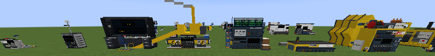

| | | |
|:-:|:-:|:-:|
| 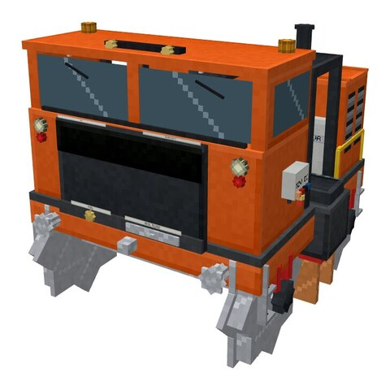 | 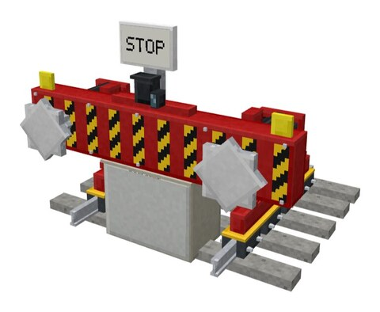 | 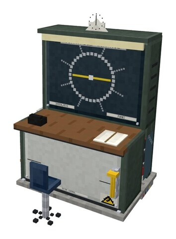 |
| Rail welder | Buffer stop | Turntable control desk |
| 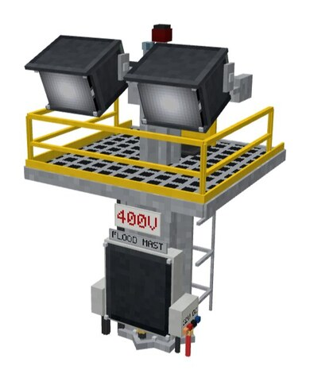 | 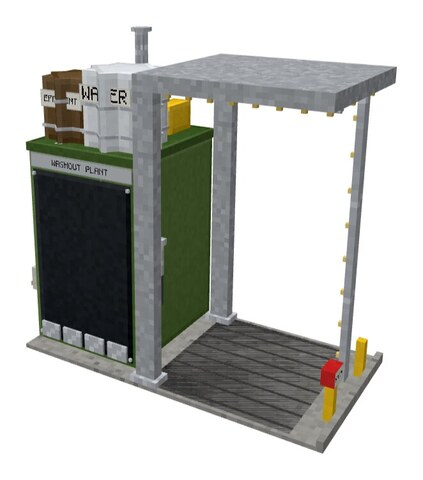 | 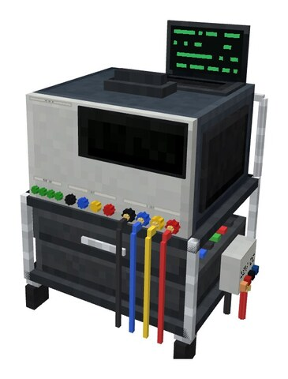 |
| Yard floodlight mast | Washout plant | Relay test set |
| 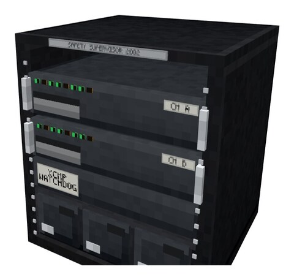 | 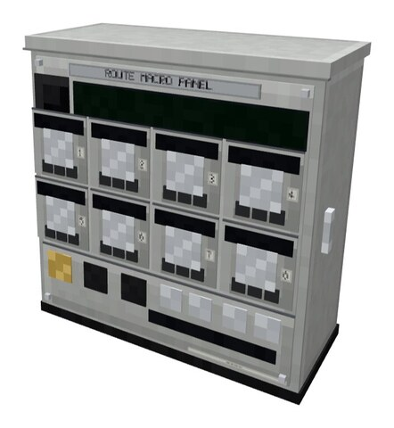 | 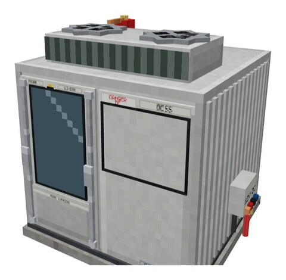 |
| Safety supervisor rack | Route macro panel | Wayside energy storage |
| 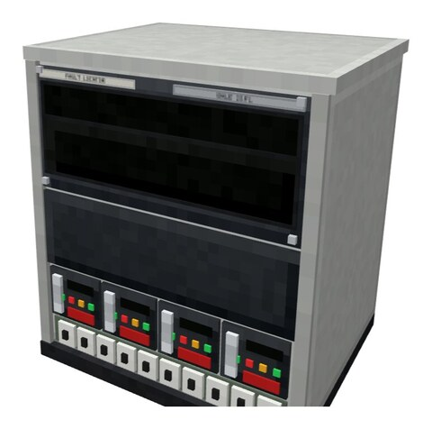 | 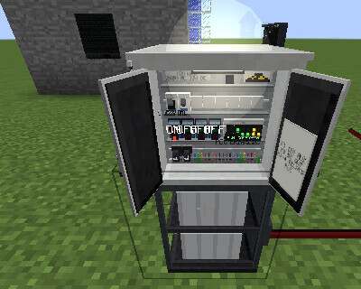 | 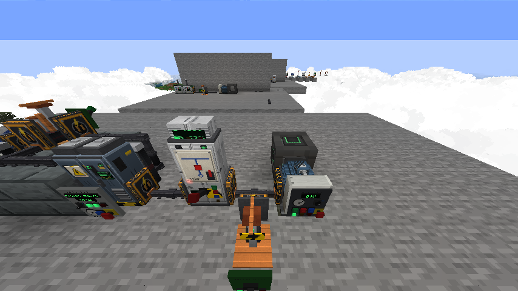 |
| OHLE fault locator | Cabinet doors open onto working internals | Real control panels |

## What's in it

About 460 blocks, 40 items and 80+ systems. Below are the headline groups; **the complete plain-language list is in
[docs/FEATURES.md](docs/FEATURES.md).**

- **Control center and driverless trains.** A 3x2 Control Center Console with a live map screen and a desk of working
  buttons, a 30-tab Control Center, driverless lines, shuttles and on-call trains, timetables, OpenTTD-style orders,
  disruption recovery, and **moving-block signalling (CBTC)** with a driver cab display.
- **Signals.** American color light, searchlight, PRR position light, B&O color position light, dwarf and semaphore
  signals, signal bridges, track circuits, axle counters, balises, trip cocks, CTC / NX route setting, interlocking, a
  real 12-lever frame, programmable signal box (WHEN / THEN / ELSE), train protection (PTC style).
- **Stations and passengers.** 12 station pieces in 4 styles, ticket machines, arrivals boards, walking passengers,
  announcements, shops and a daily newspaper.
- **Freight and yards.** Loading silos, freight contracts and the Freight Office, yard gantry crane, retarders,
  weighbridge, container tracking, an intermodal port.
- **A real power grid, 12 V to 69 kV.** Voltage levels, P / Q / S, power factor, cable sizes in mm², I²R losses,
  transformers, rectifiers, inverters, breakers with kA ratings, generators that synchronise, motors that drive any mod's
  machines, overhead line, third rail, regenerative braking. Almost every machine needs **12 V control power** through
  Instrument Wire, and big ones also need real mains.
- **Factory** (formerly the separate *Pride Industry* mod, now merged in): walk-in multiblock plants for ore
  processing, steel, rail and sleeper mills, conveyors, pipes and assembly lines, driven by electric motors.
- **CCTV.** 9 camera types with live feeds, monitors that merge into video walls, NVR recording and playback, a CCTV desk.
- **Pride OS desks.** 26 desk computers with notepad, calculator, paint, games, railway status, a terminal and music.
- **Furniture and storage.** Working drawers, filing cabinets, cupboards and display shelves that show what's on them.
- **Depots and maintenance.** Wear on wheels, brakes and engines, maintenance depot, inspection, spares, washout plant,
  rail grinder and welder.
- **Steam, battery and hydrogen trains.** Coaling tower, water column, ash pit, steam servicing depot, battery and hydrogen traction.
- **Road traffic and trams.** Traffic signal controller, road signals, pedestrian crossings and trams.
- **Ropeways and funiculars.** Stations with bullwheels, boarding gates and READY / HOLD controls.
- **Crew and ticket inspectors.** Crew office, rosters, crew NPCs, ticket inspectors.
- **Mail trains.** Sorting office, mail trains and a travelling post office.
- **Drones.** Inspection drones with a dock.
- **Model railway** table with its own control desk, and a **cinematic camera** / director desk.
- **Batch 6 (new in 0.7.0):**
  - *Building machines:* track laying machine, tunnel boring machine, ballast tamper, locomotive works, hi-rail truck.
  - *Travel:* Pride Card with card readers and top-up, a phone app, left-luggage lockers, baggage check-in and
    carousel, park and ride.
  - *Station life:* bus station, taxis, hotel, pub with kitchen, boarding lift and gap filler.
  - *New railways:* rack railway, train ferry, motorail, garden railway, avalanche galleries.
  - *Operations:* RCO beltpack (drive a loco while walking), 250 t breakdown crane, flange lubricators, master clock,
    driver training simulator.
  - *Freight and fun:* grain elevator, oil tank farm, warehouse with forklifts, parcel lockers, holiday trains.

## Requirements

- Minecraft **1.12.2** with Forge 14.23.5 or Cleanroom.
- **Immersive Railroading** and **UniversalModCore**. This build is compiled against an Immersive Railroading
  **1.11.0**-based fork (UniversalModCore 1.3.2). A few features use extra hooks that only exist in that fork
  (electric traction limits and regenerative braking, train wrecks and re-railing, walk-in interior seats). With stock
  Immersive Railroading those features are designed to switch themselves off with a log warning instead of crashing,
  but that combination has had less testing.
- Optional: Land of Signals, Dynmap, OpenComputers 1.8.9, Project Red (bundled cables), Immersive Vehicles (motorail),
  Traincraft.

## Install

1. Install Forge 1.12.2 (or Cleanroom), Immersive Railroading and UniversalModCore.
2. Download `immersive-railroading-extras-<version>.jar` from the
   [Releases](https://github.com/crunkazcanbe/immersive-railroading-extras/releases) page and put it in `mods/`.
3. If you used the old *Pride Industry* mod, remove its jar: its blocks and items are remapped into IR Extras automatically.

## How to start

1. Open creative: the **Immersive Railroading Extras** tab has the railway gear, **IR Extras: Factory** has the factory.
2. **12 V control power.** Almost every machine needs it: place a 12 V Battery Charger or UPS (or a grid 12 V supply)
   and run **Instrument Wire** to the machine's terminal box.
3. **Mains.** Big machines (the Control Center Console, workshops, plants) also need grid power: Grid Intake (takes
   power from any mod) -> Power Transformer -> Circuit Breaker (with a Protection Relay, and an Earthing Switch on the
   network) -> Feeder Cable to the machine. No power = dark screens and dead buttons.
4. Build a **Control Center Console**, click track at each stop to name stations, make a line, click a locomotive and
   choose **Make driverless**.
5. Sneak + right-click any block with the **Signal Wrench** for its Settings Console.

Keep lineside blocks at least 2 blocks from the track centre (rolling stock knocks out small blocks within its width),
and put insulated joints beside the rail, never under it.

## Commands

Main command: `/irextras <part> ...`; most parts have a `selftest`.

- `/irextras status` - everything the mod tracks plus a track scan from where you stand. **Please paste it into bug reports.**
- `/irextras list | despawn [radius]`, `consist <set>`, `wear`, `electric`, `cbtc`, `grid`, `alarm`, `contracts`, `admin`, ...
- Test helpers: `/irextras track <length>`, `stock <ids>`, `drive <throttle>`, `fill <fluid>`.
- Factory: `/irfactory <form|unform|press|status> x y z`.

The full command list is at the end of [docs/FEATURES.md](docs/FEATURES.md#32-commands).

## Config

Settings live in `config/irextras*.cfg` (main file plus `irextras_signalling`, `irextras_cargo`, `irextras_platform`,
`irextras_trainsim`, `irextras_gantry`, `irextras_depot`, `irextras_assets`, `irextras_biz`, `irextras_admin`, ...).
Highlights: autopilot speed and braking, train protection,
moving-block margins, fare item and price, wear rates, electrification on/off and how much energy trains draw. The
admin profile (`/irextras admin`) switches between **CASUAL**, **REALISTIC** and **HARDCORE**.

## Building from source

```
./gradlew build
```
Gradle needs a recent JDK; the mod targets Java 8 bytecode (modern syntax via Jabel). Put the compile-only jars listed
below into `libs/` first. Blockbench sources for the models are in [`blockbench/`](blockbench/), texture, model and
sound generators in [`tools/`](tools/). Sound credits: [CREDITS-SOUNDS.md](CREDITS-SOUNDS.md).

## Changelog

See [CHANGELOG.md](CHANGELOG.md).

## License

MIT License, (c) 2026 crunkazcanbe. Immersive Railroading, UniversalModCore and the other mods named here belong to
their authors and are not included.

## Credits

Made by crunkazcanbe.

Made with [Claude Code](https://claude.com/claude-code) and [Blockbench](https://www.blockbench.net).

## Compile-only jars

The build compiles against these jars in `libs/` (other authors' mods / APIs). They are not included in this repo; get
them from their official pages:

- `Dynmap-3.2.1-forge-1.12.2.jar`
- `ImmersiveRailroading-dev.jar`
- `LandOfSignals-1.12.2-forge-1.4.1.jar`
- `OpenComputers-1.8.9a-api.jar`
- `ProjectRed-api-4.9.4.jar`
- `TrackAPI-1.12.2-forge-1.3.jar`
- `Traincraft-4.4.1-1.12.2-dev.jar`
- `UniversalModCore-1.12.2-forge-1.3.2-a6546e1.jar`
